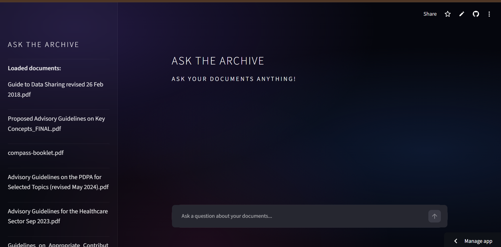

# AskTheArchive

> "It's in there somewhere. I'm sure of it!"

Singapore's compliance documents are public, free, and...also 400 pages long. Yikes!

The PDPA guidelines. The healthcare sector guidelines. The employment law guide. Every small office is supposed to have read them, and almost nobody has the time to Ctrl+F through eight PDFs at 6pm on a Friday.

AskTheArchive is for them!

Ask a question in plain English. Get an answer pulled straight from the documents, with the document name and page number attached. If the answer isn't in there, it says so instead of making something up.

**Live demo:**[ask-the-archive.streamlit.app] (https://ask-the-archive.streamlit.app/)


---

## What's in here

**[`ingest.py`](ingest.py)**

Reads every PDF and markdown file in `docs/`, splits them into overlapping 800-character chunks (so nothing gets cut off mid-thought), turns each chunk into a vector embedding, and files them in a local ChromaDB store. Runs once, not on every question.

**[`retriever.py`](retriever.py)**

Takes your question, finds the 4 chunks closest in *meaning* (not just matching keywords), and hands them to the LLM with strict instructions to answer from those chunks only. "What data do we protect?" finds the PDPA passages even if they never use those words.

**[`app.py`](app.py) + [`style.css`](style.css)**

A Streamlit chat UI while Sources sit in a collapsed expander under each answer, and the sidebar lists every loaded document.

**[`responsible-ai-note.md`](responsible-ai-note.md)**

What this tool can't do, where it can still be wrong, and why you should verify against the source. Short, honest, and worth reading.

**[`sample-questions.md`](sample-questions.md)**

Answerable questions, follow-ups, and questions that *should* fail. This is how I checked it behaves.
---

## Who this is for

A small team with no legal team and no dedicated compliance officer that handles personal data. Also anyone who wants to see what a clean, honest RAG pipeline looks like.
---

## What this is not

This is not legal advice. It's a search tool that reads public documents, and the LLM can still misread them. Always check the cited page before acting on an answer.

*(TLDR: Please don't sue me. Again.)*

For real PDPA questions, go to the [PDPC](https://www.pdpc.gov.sg) or a qualified data protection officer!
---

## How it works

Two pipelines. One runs once, one runs per question.

INGESTION (once):
PDF / MD files → page-by-page extraction → overlapping chunks →
embedding model → vectors → ChromaDB

QUERY (every question):
Question → embedding → vector search → top 4 chunks →
prompt (answer ONLY from these) → Groq LLM → answer + citations → UI

**Memory:** the last 3 exchanges are passed into the prompt so follow-ups like "how long do we have to report it?" work. It resets when you close the tab.
---

## Design decisions

**Why overlapping chunks?** Answers love to sit on chunk boundaries. A 150-character overlap means the sentence that got split still shows up whole in at least one chunk.

**Why local embeddings?** `all-MiniLM-L6-v2` runs on your machine so it's free and your documents never leave it during indexing.

**Why Groq?** Free tier, fast responses, and a one-line swap in `config.py` if I want a different model.

**Why ChromaDB?** No account, no cloud, no setup. The whole vector store is a folder.

**Why strict prompting?** The prompt tells the model to answer ONLY from the retrieved chunks, never speculate, and reply with an exact "I couldn't find this in the loaded documents." message when the answer isn't there.
---

## Setup

```bash
git clone https://github.com/laceydev/ask-the-archive.git
pip install -r requirements.txt
```

1. Get a free API key at [console.groq.com](https://console.groq.com).
2. Create a `.env` file (see `.env.example`):
   ```
   GROQ_API_KEY=your_key_here
   ```
3. Drop your PDFs or markdown files into `docs/`.
4. Index them (once): `python ingest.py`
5. Launch: `streamlit run app.py`
---

## Known limitations

Because I'd rather you hear it from me:

- **It answers questions, it doesn't summarise documents.** "Tell me everything in this PDF" retrieves only 4 chunks and will disappoint. Ask specific questions.
- **Retrieval can miss.** If the right chunk isn't in the top 4, the answer will be wrong or absent, even if the document covers it.
- **The "not found" message is prompt-enforced, not hard-coded.** The model usually obeys, but occasionally it appends a citation to it.
- **Overlapping guideline versions can blur together.** Several loaded PDFs cover similar ground, so check which document an answer came from.
- **Scanned PDFs without a text layer won't extract.**
---

## Planned for v2

- A similarity-score threshold that returns the canned message *without calling the LLM at all*
- Rewriting follow-up questions into standalone ones before searching
- PDF upload in the UI
- A confidence score for each answer
- Highlighting the source passage
- Malay, Mandarin, and Tamil support
- Export conversation as PDF
---

## Built with

| Tool | Purpose |
|------|---------|
| LangChain | Chain orchestration and retrieval |
| langchain-community | Document loaders and ChromaDB integration |
| langchain-groq | Groq LLM integration |
| Groq (llama3-8b-8192) | LLM inference, free and fast |
| ChromaDB 0.4.24 | Local vector store |
| sentence-transformers | Local embeddings (all-MiniLM-L6-v2) |
| HuggingFace (all-MiniLM-L6-v2) | Embedding model, runs locally |
| pypdf | PDF text extraction |
| python-dotenv | Environment variable management |
| numpy 1.23.5 | Pinned for ChromaDB compatibility |
| Streamlit | Chat UI and deployment |
---
## What this demonstrates

- A full RAG pipeline built end to end: ingestion, retrieval, grounded generation
- Prompt design that favours "I don't know" over a confident guess
- Honest documentation of limitations
- Shipping something complete and usable, with a live link

## References & Document Sources

The regulatory and advisory documents indexed in this project are publicly available guidelines published by Singapore Government agencies. They are formatted below according to APA 7th edition standards:

1. Cyber Security Agency of Singapore. (2021). *Cybersecurity code of practice for critical information infrastructure* (2nd ed., Rev. 1). Government of Singapore. https://www.csa.gov.sg
2. Ministry of Health & Personal Data Protection Commission. (2019). *Advisory guidelines for the healthcare sector*. Government of Singapore. https://www.pdpc.gov.sg
3. Ministry of Manpower. (2014). *Tripartite advisory on flexible work arrangements*. Government of Singapore. https://www.mom.gov.sg
4. Ministry of Manpower. (2020). *Workright guide to employment laws*. Government of Singapore. https://www.mom.gov.sg
5. Ministry of Manpower. (2023). *COMPASS: Navigating with a quick guide on Singapore's Employment Pass criteria*. Government of Singapore. https://www.mom.gov.sg
6. Personal Data Protection Commission. (2018). *Guide to data sharing* (Rev. ed.). Government of Singapore. https://www.pdpc.gov.sg
7. Personal Data Protection Commission. (2021). *Advisory guidelines on key concepts in the Personal Data Protection Act*. Government of Singapore. https://www.pdpc.gov.sg
8. Personal Data Protection Commission. (2021). *Advisory guidelines on the Personal Data Protection Act for selected topics*. Government of Singapore. https://www.pdpc.gov.sg
9. Personal Data Protection Commission. (2021). *Guide to developing a data protection management programme*. Government of Singapore. https://www.pdpc.gov.sg
10. Personal Data Protection Commission. (2022). *Guide to basic anonymisation*. Government of Singapore. https://www.pdpc.gov.sg
11. Personal Data Protection Commission. (2022). *Guide to data protection practices for ICT systems*. Government of Singapore. https://www.pdpc.gov.sg
12. Personal Data Protection Commission. (2023). *Guide on building websites for SMEs*. Government of Singapore. https://www.pdpc.gov.sg
13. Personal Data Protection Commission. (2024). *Proposed advisory guidelines on key concepts in the Personal Data Protection Act*. Government of Singapore. https://www.pdpc.gov.sg
14. Personal Data Protection Commission. (2024). *Guidelines on appropriate contribution/use of personal data*. Government of Singapore. https://www.pdpc.gov.sg